# Agendei

Sistema de agendamento para clínicas e consultórios: agenda por profissional, horários livres calculados automaticamente, bloqueio de conflitos, cadastro de clientes com histórico e painel com faturamento e taxa de comparecimento.

Projeto de portfólio full stack com **Nuxt 4 + Nuxt UI** no front e **NestJS + Prisma + PostgreSQL** no back.

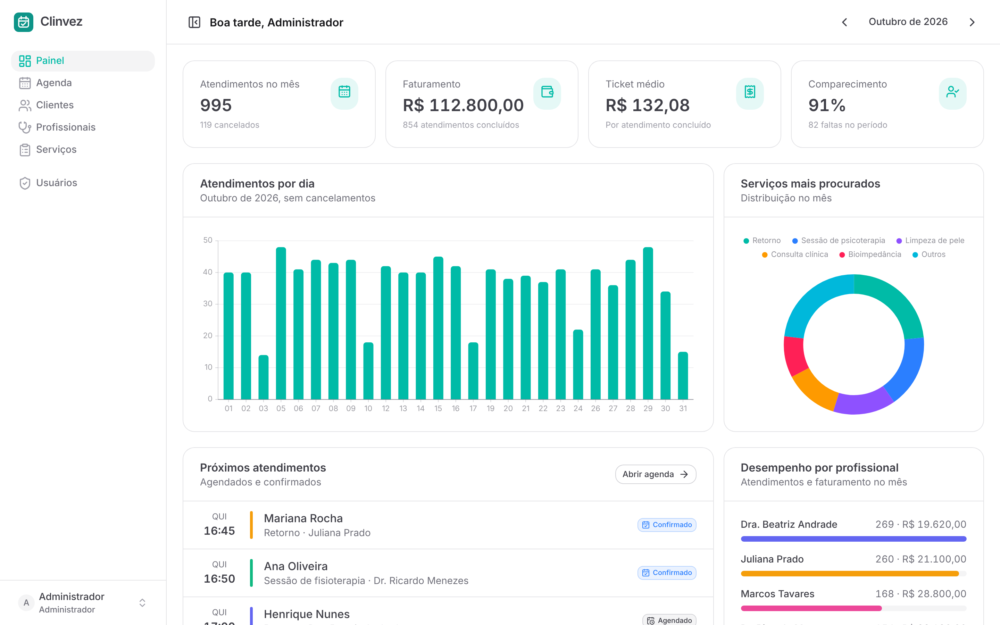

## Funcionalidades

**Agenda**
- Visão por dia (uma coluna por profissional) e por semana (por profissional)
- Clique em um horário vazio para agendar já com profissional, data e hora preenchidos
- Horários livres calculados pela API conforme a duração do serviço, o expediente (seg–sex 8h–18h, sáb 8h–12h, almoço 12h–13h) e os atendimentos já marcados
- Bloqueio de conflito no servidor: o mesmo profissional nunca fica com dois atendimentos sobrepostos
- Fluxo de status: agendado → confirmado → concluído, falta ou cancelado (com opção de reativar)
- Botão de confirmação pelo WhatsApp com mensagem pronta para o cliente
- Indicador da hora atual e atalhos de teclado (← → para navegar, T para hoje, N para novo)

**Clientes**
- Busca por nome, telefone ou e-mail com paginação
- Ficha do cliente com próximos horários, histórico, total investido, faltas e última visita

**Cadastros e acesso**
- Profissionais com cor própria na agenda e lista de serviços que realizam
- Serviços com duração e preço
- Login com JWT e dois perfis: **Administrador** (acesso total) e **Atendente** (agenda e clientes)
- Gestão de usuários pelo administrador

**Painel**
- Atendimentos, faturamento, ticket médio e taxa de comparecimento do mês
- Gráfico de atendimentos por dia, serviços mais procurados e desempenho por profissional
- Tema claro e escuro, layout responsivo

## Telas

| Agenda do dia | Agenda da semana |
| --- | --- |
| 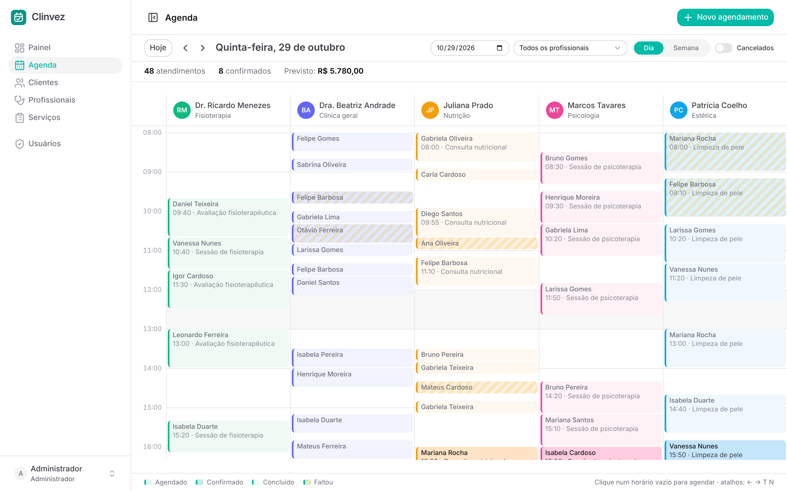 | 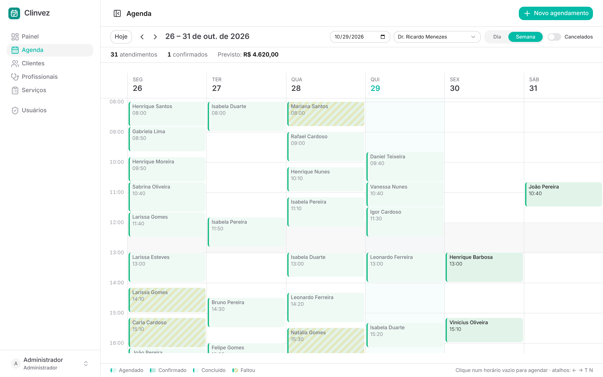 |

| Novo agendamento | Detalhes do agendamento |
| --- | --- |
| 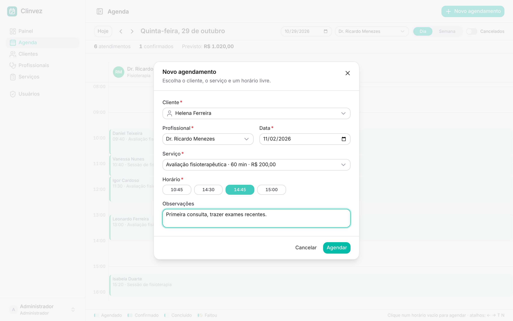 | 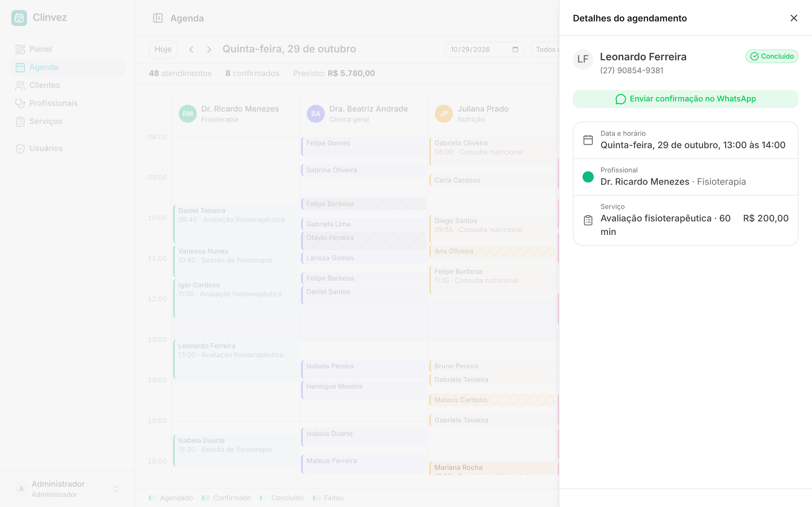 |

| Clientes | Ficha do cliente |
| --- | --- |
| 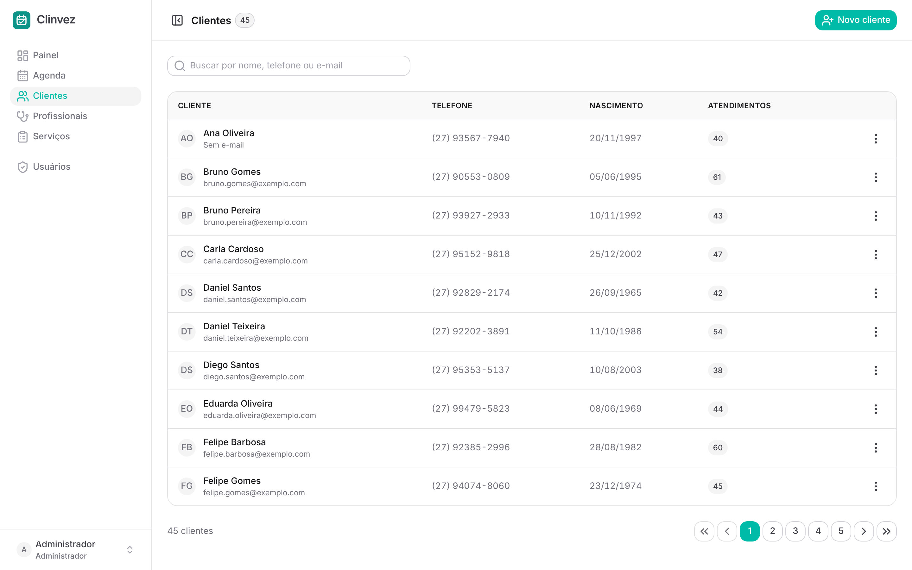 | 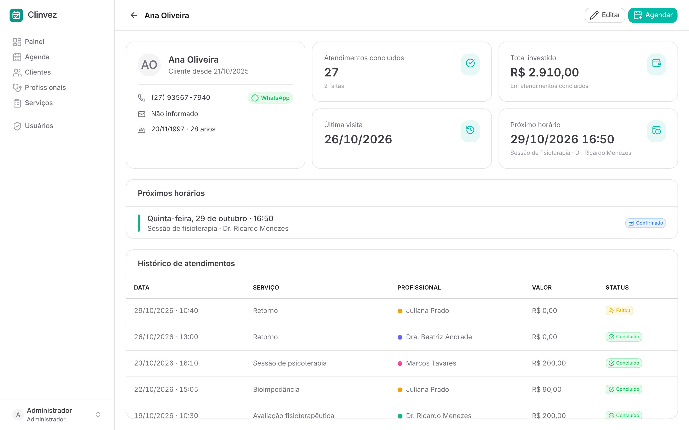 |

| Profissionais | Serviços |
| --- | --- |
| 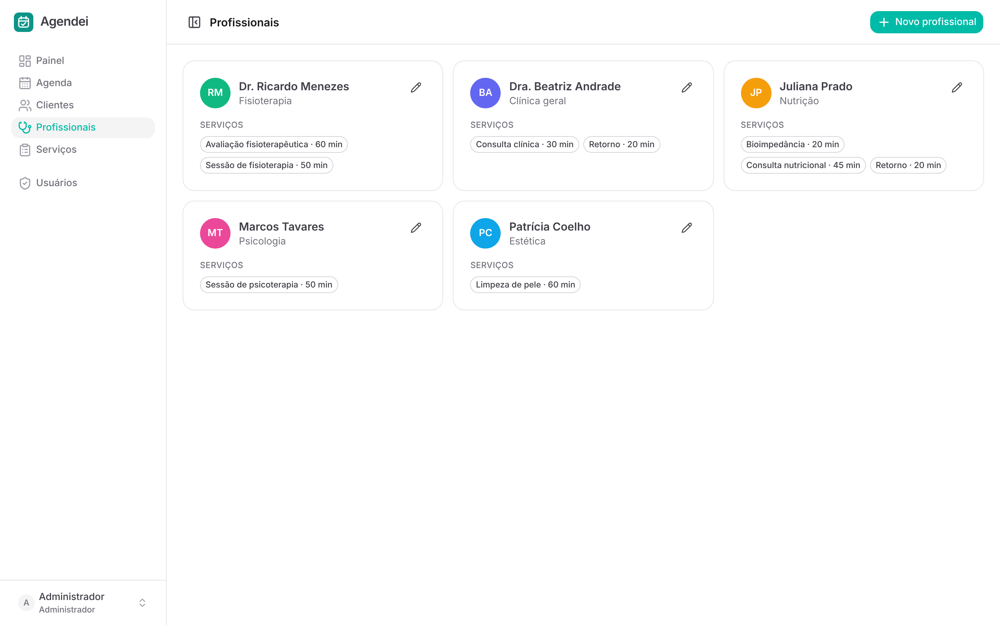 | 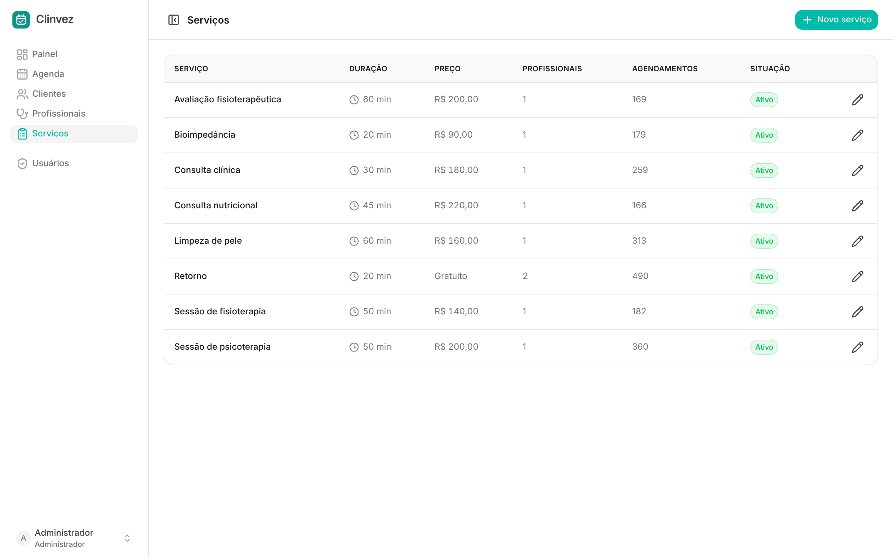 |

| Login | Tema escuro |
| --- | --- |
| 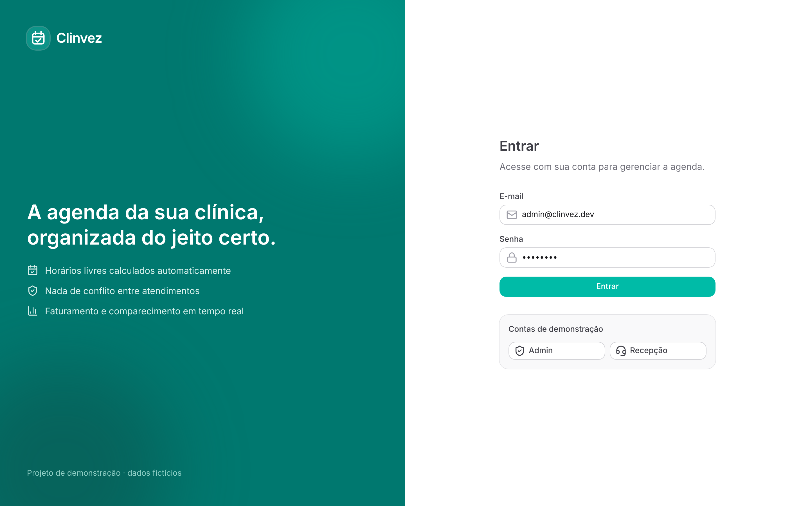 | 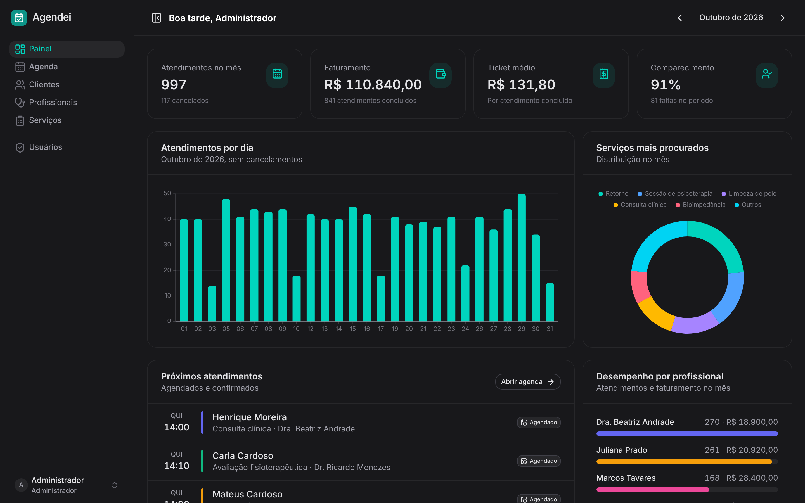 |

## Tecnologias

| Camada | Stack |
| --- | --- |
| Front-end | Nuxt 4, Vue 3, TypeScript, Nuxt UI 4, Tailwind CSS 4, Zod |
| Back-end | NestJS 11, Prisma 7 (driver adapter `pg`), class-validator, JWT |
| Banco | PostgreSQL 16 |
| Infra | pnpm workspaces, Docker Compose |

Pré-requisitos: Node 22+, pnpm 10+ e um banco PostgreSQL. Pode ser um banco gratuito na nuvem (Neon, Supabase), um PostgreSQL instalado na máquina ou o container do `docker-compose.yml`.

**1. Instalar as dependências e criar os arquivos de ambiente**

```bash
pnpm install
cp apps/api/.env.example apps/api/.env
cp apps/web/.env.example apps/web/.env
```

**2. Configurar o banco**

No `apps/api/.env`, coloque em `DATABASE_URL` a URL de conexão do seu banco. Com Docker, a URL do exemplo já funciona depois de rodar `pnpm db:up`.

**3. Criar as tabelas e popular com dados de demonstração**

```bash
pnpm db:deploy
pnpm db:seed
```

**4. Subir a API e o front, cada um em um terminal**

```bash
pnpm dev:api
pnpm dev:web
```

Para alterar o schema do banco depois, edite `apps/api/prisma/schema.prisma` e rode `pnpm db:migrate`.
```

Acesse http://localhost:3000 e entre com uma das contas de demonstração:

| Perfil | E-mail | Senha |
| --- | --- | --- |
| Administrador | admin@agendei.dev | admin123 |
| Atendente | recepcao@agendei.dev | recepcao123 |

O seed cria 45 clientes, 5 profissionais, 8 serviços e cerca de 2 mil atendimentos fictícios espalhados entre as últimas seis semanas e as próximas três, para que o painel e a agenda já abram com dados.

## Estrutura

```
agendei/
├── apps/
│   ├── api/                  NestJS
│   │   ├── prisma/           schema, migrations e seed
│   │   └── src/
│   │       ├── auth/         login, guards de JWT e de perfil
│   │       ├── agendamentos/ agenda, horários livres e conflitos
│   │       ├── clientes/
│   │       ├── profissionais/
│   │       ├── servicos/
│   │       ├── usuarios/
│   │       └── dashboard/    indicadores do painel
│   └── web/                  Nuxt
│       └── app/
│           ├── pages/        painel, agenda, clientes, profissionais, serviços, usuários
│           ├── components/   modais de agendamento e cliente, detalhe, cards
│           ├── composables/  autenticação e cliente HTTP
│           └── utils/        formatação e posicionamento dos blocos da agenda
└── docker-compose.yml
```

## Endpoints principais

Todas as rotas ficam sob `/api` e exigem `Authorization: Bearer <token>`, exceto o login.

| Método | Rota | Descrição |
| --- | --- | --- |
| POST | `/auth/login` | Autentica e devolve o token |
| GET | `/agendamentos?inicio&fim&profissionalId` | Atendimentos de um período |
| GET | `/agendamentos/horarios-livres?profissionalId&servicoId&inicioDia` | Horários disponíveis no dia |
| POST | `/agendamentos` | Cria um atendimento (valida conflito) |
| PATCH | `/agendamentos/:id` | Remarca ou altera |
| PATCH | `/agendamentos/:id/status` | Confirma, conclui, cancela ou marca falta |
| GET | `/clientes?busca&pagina&porPagina` | Lista paginada |
| GET | `/clientes/:id` | Ficha com resumo, próximos horários e histórico |
| GET | `/dashboard?inicio&fim` | Indicadores do período |
| CRUD | `/profissionais`, `/servicos`, `/usuarios` | Cadastros (escrita só para administrador) |

## Decisões técnicas

- **Conflito validado no servidor**: a checagem de sobreposição roda na API a cada criação, remarcação ou reativação, então duas recepcionistas agendando ao mesmo tempo não conseguem marcar o mesmo horário.
- **Valor gravado no atendimento**: o preço do serviço é copiado no momento do agendamento, e o faturamento histórico não muda quando o preço do serviço é reajustado.
- **Agenda sem biblioteca de calendário**: o posicionamento dos blocos e a divisão em colunas quando há sobreposição estão em `apps/web/app/utils/agenda.ts`.
- **Perfis por decorator**: `@Perfis('ADMIN')` e `@Publica()` com guards globais, sem repetir verificação nos controllers.
